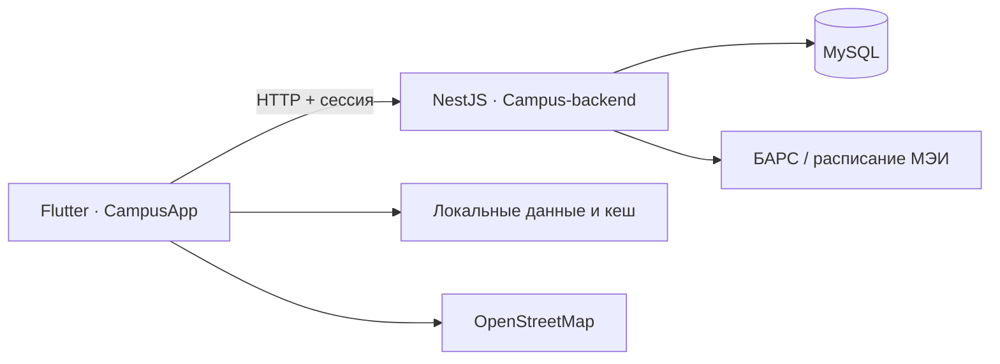

<p align="center">
  <picture>
    <source media="(prefers-color-scheme: dark)" srcset="assets/images/logo/logo_main_dark.png">
    
  </picture>
</p>

<h1 align="center">CampusApp</h1>
<p align="center">
  <strong>Твой кампус. Твоё расписание. Твои люди.</strong><br>
  Мобильное приложение для студентов НИУ «МЭИ» — учёба, сообщества и полезные сервисы в одном месте.
</p>

<p align="center">
  <a href="https://flutter.dev/"></a>
  <a href="https://dart.dev/"></a>
  <a href="https://developer.android.com/"></a>
  <a href="https://github.com/Agarych-ilya/Campus-backend"></a>
</p>

<p align="center">
  <a href="#возможности">Возможности</a> ·
  <a href="#быстрый-старт">Быстрый старт</a> ·
  <a href="#архитектура">Архитектура</a> ·
  <a href="#тестирование">Тесты</a> ·
  <a href="https://github.com/Agarych-ilya/Campus-backend">Backend ↗</a>
</p>

---

> [!NOTE]
> Проект находится в активной разработке. Актуальная рабочая ветка клиента — **[features/services-screen](https://github.com/Agarych-ilya/CampusApp/tree/features/services-screen)**, сервера — **[feature/cloud](https://github.com/Agarych-ilya/Campus-backend/tree/feature/cloud)**. Описанные ниже новые сервисы и команды ориентированы на эти ветки; они могут отсутствовать в текущем коде main.

<a id="возможности"></a>
## Учебный журнал старосты (feature/BARS-starosta)

При подтверждении входа старосты **бэкенд** автоматически считывает
список студентов именно его подтверждённой группы из БАРС и сохраняет
в MySQL. Flutter получает готовый список через защищённый API.
Скрытый WebView для сбора ФИО больше не используется.
При временной ошибке есть кнопка «Повторить загрузку»: сервер повторно
получает список по действующей сессии БАРС, не показывая страницы сайта.

Староста выбирает только отсутствующих и подтверждает результат.
После закрытия журнала отсутствующему студенту показывается красная
буква «Н» в правом верхнем углу соответствующей пары.
Официальный БАРС при этом не изменяется.

Перед первым запуском серверу нужен Chromium:
`cd Campus-backend; npm ci; npx playwright install chromium`.
Подробнее: [backend API](https://github.com/Agarych-ilya/Campus-backend/blob/feature/BARS-starosta/docs/attendance-journal.md).

## ✨ Возможности

| Раздел | Что уже есть |
|:--|:--|
| 📅 **Расписание** | Занятия по группе, переключение недель, получение через backend и локальный кеш. |
| 🗺️ **Карта кампуса** | Интерактивная карта МЭИ на OpenStreetMap, поиск корпусов и выбранных объектов. |
| 👤 **Профиль** | Данные студента, оценки и учебная статистика. |
| 👥 **Сообщества** | Каталог, категории и поиск, Telegram/VK, заявки на новые группы и модерация. |
| 🛍️ **Маркет** | Продажа и бесплатная передача вещей, фотографии, фильтры, избранное и контакты. |
| 🔎 **Бюро находок** | Объявления «Нашли» / «Ищут», место и фотографии, связь с автором. |
| 🧠 **Campus Cards** | Свои и публичные наборы, карточки, тесты, поиск, рейтинг ★, активность на 17 недель. |
| ☁️ **Cloud Campus** | Загрузка, просмотр списка и получение файлов через API. |
| 📷 **QR-сканер** | Сканирование камерой; ссылки открываются только по действию пользователя. |
| 📳 **NFC** | Чтение доступных данных NFC-карты и сохранение локальной записи. |

**В разработке:** встроенные чаты — текущая вкладка пока заглушка. NFC-модуль **не копирует пропуск и не открывает турникеты**.

<a id="быстрый-старт"></a>
## 🚀 Быстрый старт

### Сборка проекта

`CampusApp` — **Flutter-клиент**, а `Campus-backend` — отдельный сервер на NestJS.
В корне `CampusApp` команда `npm run build` теперь является удобным
псевдонимом для сборки Android APK через Flutter (Node.js-зависимостей у
клиента нет):

```powershell
# Находясь в корне CampusApp
npm run build
# То же самое без npm: flutter build apk --release
```

Для этой команды необходимы Flutter SDK и настроенный Android SDK.
Результат: `build/app/outputs/flutter-apk/app-release.apk`.

Если нужно собрать именно **NestJS-бэкенд**, открой его папку, в которой
находится собственный `package.json`:

```powershell
cd ..\Campus-backend  # если оба проекта лежат рядом
npm ci
npm run build
```

`npm ci` выполняется при первой установке и после изменения зависимостей.
Не требуется копировать серверный `package.json` в Flutter-проект.

### Требования

- [Flutter SDK](https://docs.flutter.dev/get-started/install) с Dart, совместимым с sdk: ^3.9.2.
- Git, Android SDK и эмулятор или Android-телефон с USB-отладкой.
- Для серверных функций — [Campus-backend](https://github.com/Agarych-ilya/Campus-backend) на порту **8000**.

<details>
<summary><b>Шаг 1 · Запустить backend</b></summary>

В отдельном PowerShell:

```powershell
git clone https://github.com/Agarych-ilya/Campus-backend.git
cd Campus-backend
git switch feature/cloud
npm ci
Copy-Item .env.example .env
# Настрой MySQL и секреты в .env
npm run start:dev

# В другом терминале
curl.exe http://127.0.0.1:8000/health
```

Перед запуском создай БД MySQL. Подробности — [README backend](https://github.com/Agarych-ilya/Campus-backend/blob/feature/cloud/README.md#быстрый-старт).

</details>

### Шаг 2 · Запустить Flutter

```powershell
git clone https://github.com/Agarych-ilya/CampusApp.git
cd CampusApp
git switch features/services-screen
flutter pub get
flutter devices
```

**На Android-эмуляторе через ADB Reverse (рекомендуется):**

```powershell
& "$env:LOCALAPPDATA\Android\Sdk\platform-tools\adb.exe" -s emulator-5554 reverse tcp:8000 tcp:8000

flutter run -d emulator-5554 --dart-define=CAMPUS_API_BASE_URL=http://127.0.0.1:8000
```

**На физическом Android-телефоне по USB:**

```powershell
flutter devices
# Замени <DEVICE_ID> на идентификатор своего устройства
& "$env:LOCALAPPDATA\Android\Sdk\platform-tools\adb.exe" -s <DEVICE_ID> reverse tcp:8000 tcp:8000

flutter run -d <DEVICE_ID> --dart-define=CAMPUS_API_BASE_URL=http://127.0.0.1:8000
```

Разблокируй телефон и разреши USB-отладку. Если `flutter devices` показывает `unauthorized`, подтверди доверие к компьютеру на устройстве.

> [!IMPORTANT]
> Для обычных API-запросов Android-эмулятор может использовать `10.0.2.2:8000`. Но для передачи **cookie БАРС** при подтверждении прав сервер требует HTTPS либо локальное подключение (`127.0.0.1` + ADB Reverse). Не отправляй сессионные cookie по открытому HTTP через Wi-Fi.

### Шаг 3 · Проверить соединение

1. `curl.exe http://127.0.0.1:8000/health` должен вернуть `{"status":"ok"}`.
2. Backend должен быть запущен, а MySQL доступна.
3. Проверь проброс: `adb reverse --list` для нужного устройства.
4. Проверь `CAMPUS_API_BASE_URL`; явно заданный адрес отключает автоматический перебор других адресов для расписания.

### Бронирование аудиторий из расписания

Для М-307 и В-308, а также новых аудиторий из серверного каталога
`GET /services/room-bookings/rooms`, доступна кнопка выбора места прямо
в карточке пары. Дата и время передаются из расписания.

Flutter использует универсальный `ServerRoomSeatMap`, а
`GET /services/room-bookings` возвращает занятые места и серверную
`layout`-схему с координатами. Разметка аудиторий, розетки и проходы
хранятся в MySQL backend, а не в коде мобильного приложения.

**Для проверки изменений в расписании выбери ветку:**

```powershell
git switch feature/schedule-screen
git pull origin feature/schedule-screen
flutter run -d emulator-5554 --dart-define=CAMPUS_API_BASE_URL=http://127.0.0.1:8000
```

До запуска Flutter обнови backend (`feature/cloud`) и запусти NestJS,
подключённый к MySQL. Описание формата: [backend/docs/room-layouts.md](https://github.com/Agarych-ilya/Campus-backend/blob/feature/cloud/docs/room-layouts.md).

### Cloud Campus — папки, общие материалы и предпросмотр

В карточке хранилища теперь рядом показаны небольшие показатели
**«Занято»** (красным) и **«Осталось»**; лимит — 500 МБ.
«Личное» — единственное имя приватного доступа в интерфейсе.
Переключение прав отдельного файла с «Личное» на «Всем»/«Моя группа»
выполняет проверенный перенос без видимого дубликата. Русские имена
файлов сохраняются при загрузке и скачивании.

Новая версия облака: **единый поиск по файлам и папкам**,
сохранение найденных конспектов, миниатюры изображений,
отдельные действия «Переименовать» и «Настроить доступ» для папок,
копируемые ссылки на скачивание с возможностью отзыва.

**«Личное»** — единый уровень доступа, а не два разных режима «Личное»
и «На устройстве». Новые личные файлы хранятся в приватной папке приложения
(без загрузки на сервер и без Android Auto Backup).
«Моя группа БАРС» и «Всем» — размещение на backend с серверной
проверкой доступа. Если удалить приложение или его данные, личные файлы
будут потеряны; на другом устройстве автоматически не появятся.

Папка «Моя группа» или «Всем» теперь может быть переключена обратно
на **«Личное»**. CampusApp скачивает и проверяет все файлы, сохраняет
полную папку в локальном хранилище и только затем вызывает backend,
который одним запросом удаляет собственные серверные файлы, саму папку
и ссылки на них. При обрыве скачивания удаление не производится.
Сохранённые чужие файлы копируются локально, но чужие оригиналы остаются
у своих владельцев.

При переключении локальной папки на «Моя группа» / «Всем» она
**переносится**, а не дублируется: содержимое сначала загружается во временную
приватную папку сервера, затем скачивается и сравнивается побайтово.
Только после проверки включается общий доступ и локальная папка удаляется.
Повторная попытка продолжает тот же перенос, не создавая новую папку.
Личная папка не синхронизируется между устройствами и пропадает при
удалении данных приложения.

Если старая версия уже создала одноимённые локальную и серверную UBS,
Cloud Campus показывает **одну карточку**. При переходе «Личное» →
«Моя группа»/«Всем» приложение **объединяет файлы обеих копий**:
совпадающие байтово не загружаются повторно, существующие на сервере
остаются, новые загружаются. Если одинаковые имена обозначают разное
содержимое, локальная версия сохраняется с суффиксом «(с устройства)»
перед расширением файла. Только после побайтовой проверки всех локальных
файлов локальная папка удаляется. При ошибке сеть/загрузка исходники
остаются на телефоне, повторная попытка не создаёт дубликатов.

Для публичного доступа к файловым ссылкам требуется
`CAMPUS_PUBLIC_URL` с реальным HTTPS-адресом.

Главный экран разделён на «Папки» и «Файлы». Корневые файлы показываются
отдельно от папок. Файлы внутри папки не дублируются на главном экране; они доступны после
открытия папки или через поиск по всем доступным именам. Владельцы могут
переименовывать файлы без изменения расширения. Для серверных папок
доступны ссылка на просмотр/скачивание и отзыв ссылки. Любой обладатель
действующей ссылки получит доступ к файлам папки, поэтому перед отправкой
приложение просит подтвердить публикацию. Для личной локальной папки
ссылка недоступна без предварительной загрузки материалов в облако.

Через «Создать → Импорт по ссылке Яндекс Диска» можно скачать публичный
файл или **ZIP-архив публичной папки** (до 20 МБ), а затем выбрать личное
или общее хранение. Личные ссылки, требующие авторизации Яндекса,
не поддерживаются. Старые серверные приватные файлы сохраняются на сервере
до явного переноса и помечаются отдельно.

Чтобы проверить Cloud Campus, нужны обновлённый backend `feature/cloud`
и Flutter `feature/schedule-screen`. Вход повторно не требуется:
используется существующая подтверждённая сессия БАРС.

Ранее загруженные файлы из старой таблицы `cloud` автоматически
не появляются в новой личной библиотеке — для них не было данных о
владельце. Их можно заново загрузить безопасно.

Подробнее: [Cloud Campus API и политика доступа](https://github.com/Agarych-ilya/Campus-backend/blob/feature/cloud/docs/cloud-campus.md).

<a id="архитектура"></a>
## 🧩 Архитектура



```text
lib/
├── app/                  # Навигация
├── core/                 # Конфигурация API и темы
└── features/
    ├── auth/             # Вход и БАРС
    ├── bars/             # Информация о студенте
    ├── schedule/         # Расписание и кеш
    ├── map/              # Карта
    ├── profile/          # Профиль, оценки, статистика
    └── services/
        ├── cloud/        # Файлы
        ├── listings/     # Маркет и бюро находок
        ├── study/        # Campus Cards
        ├── nfc/          # NFC-карты
        ├── qr/           # QR-сканер
        └── view/         # Сообщества и каталог
```

| Локально на устройстве | На сервере |
|:--|:--|
| Кеш расписания, личные наборы Campus Cards, история занятий и часть настроек | Общие учебные наборы и рейтинги, объявления, сообщества, файлы |

<a id="тестирование"></a>
## 🧪 Тестирование

```powershell
flutter analyze
flutter test

# Отдельные тесты учебных сервисов
flutter test test/features/services/study/study_activity_test.dart
flutter test test/features/services/study/public_study_api_test.dart
flutter test test/features/services/study/study_deck_test.dart
```

**Стек:** `Flutter` · `Dart` · `http` · `shared_preferences` · `flutter_map` · `mobile_scanner` · `nfc_manager` · `webview_flutter`.

## 🔐 Безопасность и ограничения

- Административные действия подтверждаются **сервером** по существующей сессии БАРС и разрешённому списку; одного имени из профиля недостаточно.
- Не коммить `.env`, реальные данные студентов, пароли, ключи API и cookie БАРС.
- Публичный набор Campus Cards становится доступен другим студентам вместе с выбранным именем автора.
- Тайлы OpenStreetMap требуют доступа к сети.
- Это развивающийся студенческий проект, а не официальный клиент БАРС или пропускная система МЭИ.

---

<div align="center">
  <b>CampusApp</b> — всё, что нужно студенту, в одном приложении.<br>
  <sub><a href="https://github.com/Agarych-ilya/CampusApp">Flutter</a> · <a href="https://github.com/Agarych-ilya/Campus-backend">Backend</a></sub>
</div>